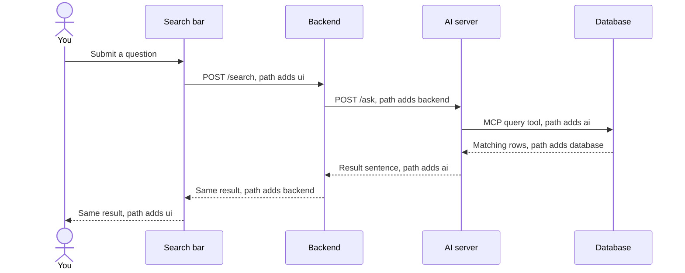
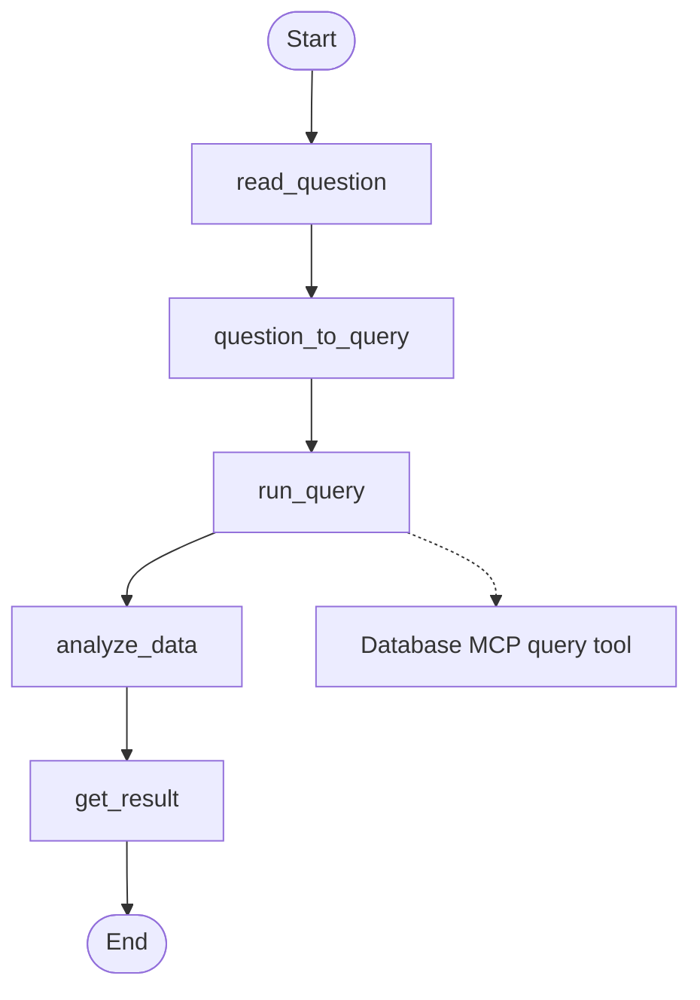

# How the app works

You type a question in the search bar. The search bar sends it to the backend, and the backend sends it to the AI server. The AI server then asks the database, and the result comes back along the same path. Ports, startup commands, and the checks for this path are in [How the app servers work](HOW_THE_APP_SERVERS_WORK.md) and [How to verify the servers](HOW_TO_VERIFY_SERVERS.md).

## High-level flow

The search bar is the page on port 8000. The backend is on port 8001, the AI server is on port 8002, and the database is on port 8003. Each app adds its own name to the `path` list before it calls the next app. The database adds `database` when it returns the matching rows. The AI server, the backend, and the search bar each add their name again on the way back. A complete path is `ui`, `backend`, `ai`, `database`, `ai`, `backend`, `ui`.

The AI server does not call the database with `POST /query`. It calls the database tool named `query` on the MCP server at `/mcp`. MCP is the protocol the AI server uses to call that tool. The tool returns the same rows that `POST /query` would return.

## AI agent graph

`POST /ask` on the AI server runs one graph, `explorer_graph`. The graph is a fixed sequence. It does not call a language model. Two steps are stubs for later model calls, and the query step is the only step that calls another app.

`read_question` keeps the question that arrived with the request. `question_to_query` is the stub for the model call that will write a database query from the table schemas and the example queries. Today that stub checks that those lists exist, and then it sends the question on unchanged. `run_query` calls the database `query` tool and copies the returned rows and path into the graph state. `analyze_data` is the stub that writes one result sentence from those rows. `get_result` returns that sentence.

